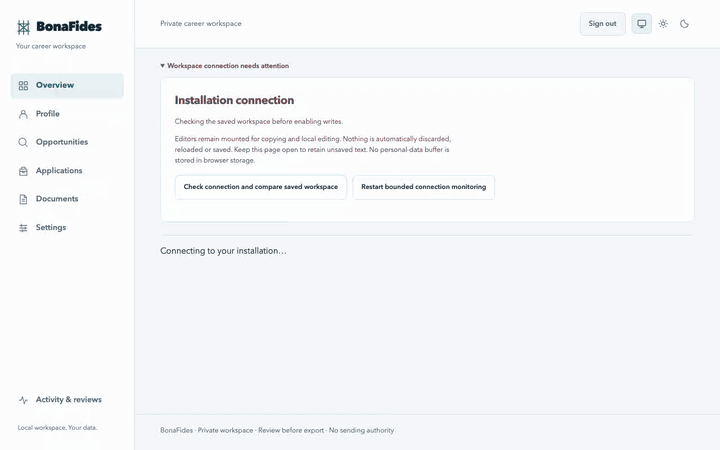

# BonaFides

**Your job search. Your data. Your AI.**

BonaFides is a private workspace for your job search that runs on your own computer. You keep a record of your experience with the evidence behind it, and BonaFides turns it into résumés and cover letters that only say what you can back up. It also keeps track of the jobs you're considering and the applications you've made.



*The recording shows the real interface with made-up demo data. A test stand-in plays the part of the AI model.*

## What it does

- **Keeps your evidence with your facts.** Every fact in your profile is linked to the passage that supports it: a reference letter, a review, a certificate, or your own written statement.
- **Brings in your existing résumé.** BonaFides reads a PDF or text résumé and proposes entries for you to check. Nothing is added until you approve it.
- **Organizes job postings.** Paste in jobs you're interested in, mark the ones worth pursuing, and confirm what each one requires.
- **Builds résumés you can stand behind.** A base résumé is made directly from your profile, without AI. With an optional AI model on your own computer, BonaFides can also write a résumé and cover letter tailored to one job.
- **Catches statements you can't support.** Any factual sentence that doesn't come from your profile is flagged and blocks export until you fix it.
- **Exports a PDF** of the exact version you checked and approved.
- **Tracks your applications:** stages, notes, contacts, follow-ups and interviews.

## What it won't do

- **It never applies, emails or contacts anyone for you.** You send your applications yourself.
- **It never sends your data to the cloud.** There's no online account. AI is off unless you set up a model on your own computer or private network, and nothing goes to it without your confirmation each time.
- **It never makes up facts or verifies them.** It checks that your documents match your profile; whether your profile is true is up to you.

## Is it ready for me?

BonaFides is at an early stage (version 0.1.0) and isn't a finished product yet. Before you rely on it, know that:

- It runs on **Mac or Linux** computers using Docker. It's mainly tested on Macs with Apple silicon. Windows isn't supported.
- Installing and starting it means typing a few commands into a terminal. The [getting started guide](docs/user-guide/getting-started.md) walks you through every one.
- AI tailoring and encrypted backups need extra technical setup.
- It hasn't yet been through independent testing with users, and its AI-written documents haven't been reviewed by people for accuracy.

## Install

You need [Docker Desktop](https://www.docker.com/products/docker-desktop/) (on Linux, Docker Engine with Compose and Buildx) running, and Git. Then, in a terminal:

```sh
git clone https://github.com/Mathews-Tom/BonaFides.git
cd BonaFides
sh install.sh
sh start.sh
```

The first installation builds BonaFides on your computer, which can take a while. When `start.sh` finishes, it prints the address to open, usually **http://localhost:8000**.

To create your account, you need the one-time setup code. Show it with:

```sh
cat "$HOME/bonafides/secrets/bootstrap_token"
```

Enter the code, choose a login name and a password of 15 to 128 characters, and select **Create account**. The code works for 15 minutes; if it expires, run `sh start.sh` again. Keep the code private.

Stop BonaFides with `sh stop.sh` and start it again with `sh start.sh`. Your data stays in between.

The [getting started guide](docs/user-guide/getting-started.md) covers each step in detail, including how to try BonaFides with demo data.

## Learn more

- [User guide](docs/user-guide/README.md): how BonaFides works and how to use every page.
- [Your data and privacy](docs/user-guide/your-data.md): what's stored, what can leave your computer, exports and deletion.
- [Optional AI tailoring](docs/user-guide/ai-tailoring.md): what the AI receives and how it's kept honest.
- [Manage your installation](docs/user-guide/manage-installation.md): updating, a second installation and uninstalling.
- [Troubleshooting](docs/user-guide/troubleshooting.md).

## How well the checks work

BonaFides's honesty checks have been measured on made-up test data:

- **Unsupported statements:** the checker caught every kind of exaggeration it was built to catch, and wrongly flagged 2 of 1,175 honest statements.
- **One known gap:** a sentence cut short so that it drops a limiting phrase at the end ("in the pilot team") isn't caught. Always read what you approve.
- **AI writing:** on a Mac, `qwen2.5:7b-instruct` passed all 20 format tests for both document pairs and single-section rewrites through the installed commands. Its factual statements passed the wording checks at rates of 98% and 100%, respectively. This is not a human review of accuracy or writing quality.

These tests check structure and wording against your profile, not writing quality. Details are in the [developer guide](docs/development/README.md#structured-claim-evidence-matching).

## For developers

BonaFides is a Python (FastAPI) and React application that runs as a set of isolated Docker containers with a PostgreSQL database.

- [Documentation index](docs/README.md)
- [Developer guide](docs/development/README.md): toolchain, local development, checks, feature contracts and release gates.
- [Architecture](docs/architecture/README.md): containers, isolation boundaries and update procedure.
- [Contributing](CONTRIBUTING.md), [security policy](SECURITY.md) and [changelog](CHANGELOG.md).

## License

BonaFides is available under your choice of the [MIT License](LICENSE-MIT) or the [Apache License 2.0](LICENSE-APACHE). See [NOTICE](NOTICE) and the [licensing decision](docs/decisions/ADR-0001-dual-licensing.md). Public distribution is still subject to a pending rights review; see the [release compliance checklist](docs/compliance/release-compliance-checklist.md).
