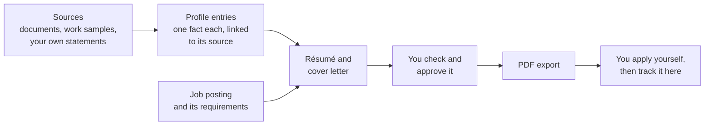

# BonaFides user guide

BonaFides helps you keep an honest, well-organized record of your working life and turn it into résumés and cover letters that only say things you can back up. It runs on your own computer. Nothing you enter is sent anywhere unless you set that up yourself.

This guide is written for people who want to *use* BonaFides. You don't need to know how it's built. If you want to change or test the code, read the [developer guide](../development/README.md) instead.

## How BonaFides works

BonaFides is built around one idea: **every fact on your résumé should point back to something that supports it.**

1. **Collect sources.** A source is anything that supports a fact about you: a reference letter, a performance review, a project write-up, a certificate, or simply your own written statement.
2. **Write profile entries.** Each entry is one fact, such as a job, a skill or an achievement. You link it to the exact passage in a source that supports it.
3. **Add job postings.** Paste in roles you're interested in and confirm what each one asks for.
4. **Create documents.** BonaFides builds a résumé from your entries. With an optional AI model set up, it can also write a résumé and cover letter tailored to one job. Every factual sentence must come from one of your entries; anything else is flagged and blocks export.
5. **Check, approve and export.** You review the exact version you'll send, then download it as a PDF.
6. **Track the application.** You apply through the employer's own website or email. BonaFides keeps your notes, stages, contacts and follow-ups.

## A quick tour

After you sign in, the menu on the left has these pages:

| Page | What it's for |
|---|---|
| **Overview** | Where you left off: imports waiting for review, recent activity, follow-ups that are due and upcoming interviews. |
| **Profile** | Your personal details, your sources, and your profile entries. The **Résumé imports** tab brings in an existing résumé. |
| **Opportunities** | Job postings you've added, your decision on each one, and what each job requires. |
| **Applications** | The jobs you're pursuing: stage, notes, contacts, follow-ups, interviews and files. |
| **Documents** | Your base résumé and any tailored résumé and cover letter pairs. Review and PDF export happen here. |
| **Settings** | Password, data export, data replacement and deletion. |
| **Activity & reviews** | Background tasks such as imports, document generation and PDF rendering, and anything waiting for your review. |

The theme switch (**System theme**, **Light theme**, **Dark theme**) and **Sign out** sit in the top bar.

## Guide contents

1. [Getting started](getting-started.md): install BonaFides, start it and create your account.
2. [Build your profile](profile.md): personal details, sources and entries.
3. [Import an existing résumé](resume-import.md): turn a résumé you already have into profile entries.
4. [Find and review jobs](opportunities.md): add postings, decide what to pursue and review what each job requires.
5. [Create résumés and cover letters](documents.md): build, check, approve and export documents.
6. [Track your applications](applications.md): stages, notes, contacts, follow-ups and interviews.
7. [Activity and background tasks](activity.md): follow, cancel or retry work that runs in the background.
8. [Account and settings](account-and-settings.md): signing in, passwords, unsaved changes and lost connections.
9. [Your data and privacy](your-data.md): what is stored, what can leave your computer, exports, moving and deleting data.
10. [Optional AI tailoring](ai-tailoring.md): what the AI does, what it receives and how it is kept honest.
11. [Manage your installation](manage-installation.md): stop, start, update, run a second copy and uninstall.
12. [Troubleshooting](troubleshooting.md): common messages and what to do about them.

## What BonaFides never does

- **It never applies for you.** It doesn't submit applications, send email or create calendar events. Recording "Applied" is a note for you, not proof that anything was delivered.
- **It never fetches the web links you paste.** A posting's reference link is stored for you to open yourself.
- **It never uses a cloud AI service.** AI is off until someone sets up a model running on your own computer or private network, and even then nothing is sent without your confirmation for each task.
- **It never makes up facts.** A generated sentence that isn't backed by one of your entries is shown as a problem and blocks review and export. Approving a document can't override that.
- **It never verifies your credentials.** Your entries are *your* statements, backed by sources you supply. BonaFides checks that your documents match your entries, not that your entries are true.
- **It never merges, deletes or rejects anything on its own.** Duplicate postings are only marked, archived items are kept, and deleting data always needs a preview and your typed confirmation.

## Words you'll see

| Term | Meaning |
|---|---|
| **Owner** | You. Each installation has exactly one account. |
| **Source** | Something that supports a fact about you: text from a document, a work sample, a web page, a credential, or your own statement. |
| **Owner attestation** | A source that is simply your own statement. It is recorded as unverified. |
| **Entry** (also called a **claim**) | One fact in your profile, such as a job, a skill or an achievement. |
| **Evidence link** and **source excerpt** | The connection between an entry and the exact passage in a source that supports it. |
| **Revision** | A saved version. BonaFides keeps earlier versions of your profile and documents so you can look back or restore them. |
| **Posting** | A job advert you've added. |
| **Requirement** | Something a posting asks for, which you confirm from the posting's own text. |
| **Disposition** | Your private decision on a posting: saved, dismissed, archived or unmarked. |
| **Application** (or **attempt**) | Your pursuit of one saved posting, with its stage and history. |
| **Base résumé** | A general résumé built from your profile, without AI. |
| **Tailored documents** | A résumé and cover letter written for one tracked application, using an AI model. |
| **Model route** | The connection to an AI model. Tailoring is only available once a route has been set up and tested. |
| **Blocker** | A problem in a document, such as an unsupported statement, that stops review and export until it's fixed. |
| **Task** | Work that runs in the background, such as reading a résumé or rendering a PDF. |
